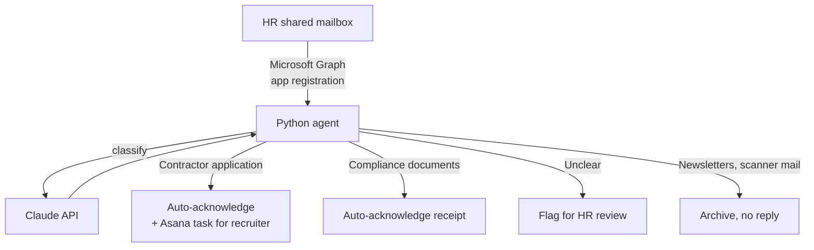

# HR Mailbox AI Agent (design)

> Design for an AI agent that reads an HR shared mailbox, classifies each email with Claude, sends the right acknowledgment, and routes action items to the right person in Asana.

**Built for:** a facility services franchise, where I'm the sole IT person
**When:** May 2026
**Status:** Analysis and design complete; implementation not started
**Stack (planned):** Python · Claude API · Microsoft Graph API · Entra app registration with MSAL (client credentials) · Asana API · PowerShell (Outlook PST export)
**My role:** Analysis, design and business plan.

> The mailbox data and plan documents belong to my employer and stay private. This page describes the design.

---

## The problem

The HR shared mailbox gets dozens of emails a week from contractors, applicants and people sending compliance documents. HR staff read each one by hand and decide what to do.

## What I did

- Exported the mailbox and analyzed **8,809 emails** with a PowerShell export script to find what actually arrives.
- Defined the categories and classification rules from real examples.
- Wrote the acknowledgment email templates.
- Chose the stack and the authentication approach, and wrote a business plan for leadership.

## Design

| Category | Agent action |
|---|---|
| Contractor application | Acknowledge the sender, create an Asana task for the recruiter |
| Compliance document submission | Acknowledge receipt |
| Ambiguous | Flag for a person to review |
| Noise (newsletters, scanner notices) | Archive, no reply |

## Planned build

1. Entra app registration in the franchise tenant (with admin consent for mail permissions)
2. Python agent: fetch, classify, respond, route
3. Read-only test against the live mailbox first
4. Asana integration, then hand-off to HR staff with no code needed day to day

The outbound side was later covered by the [Contractor Compliance System](https://github.com/Matteoinfl/contractor-compliance-system), which sends compliance emails from an HR mailbox through a permission scoped to just that one mailbox.

---

*Part of a set of tools I built as the sole IT person at a facility services franchise. See my [profile](https://github.com/Matteoinfl) for the others.*
